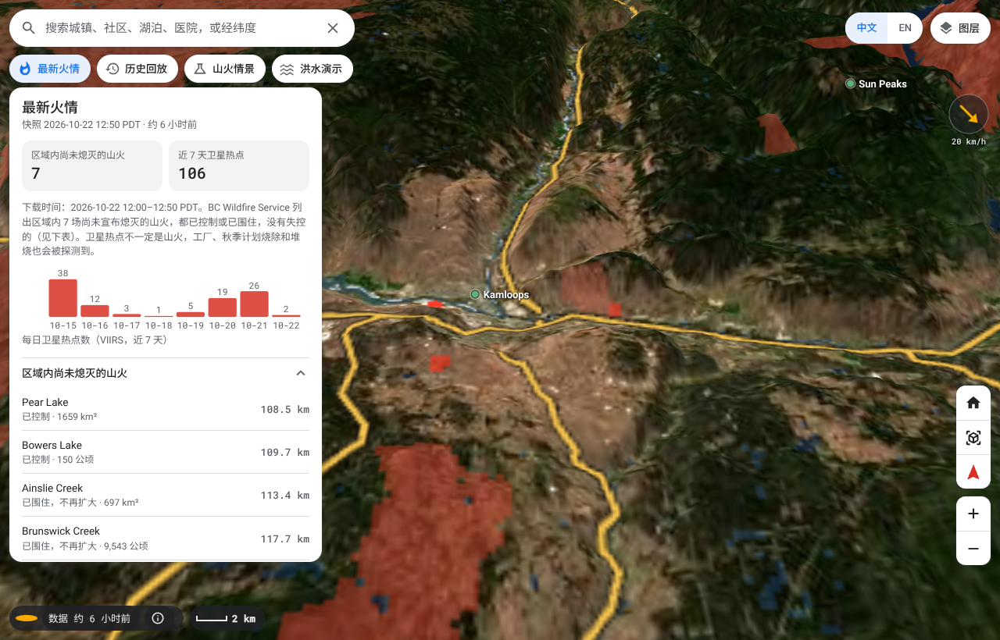
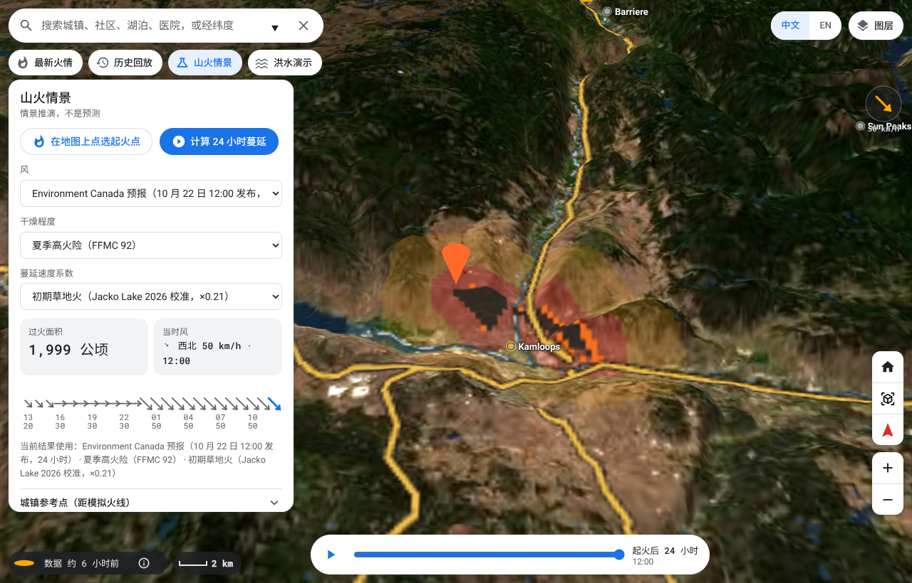
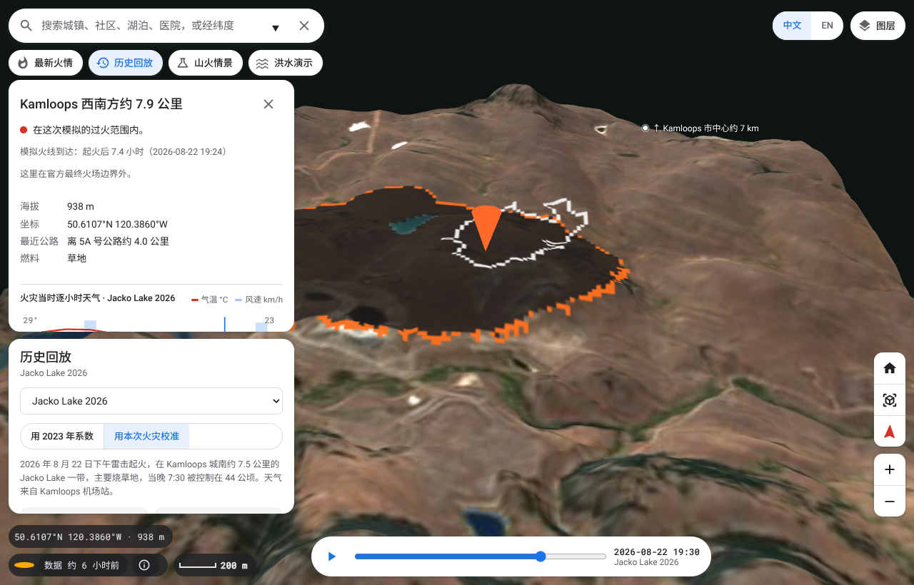
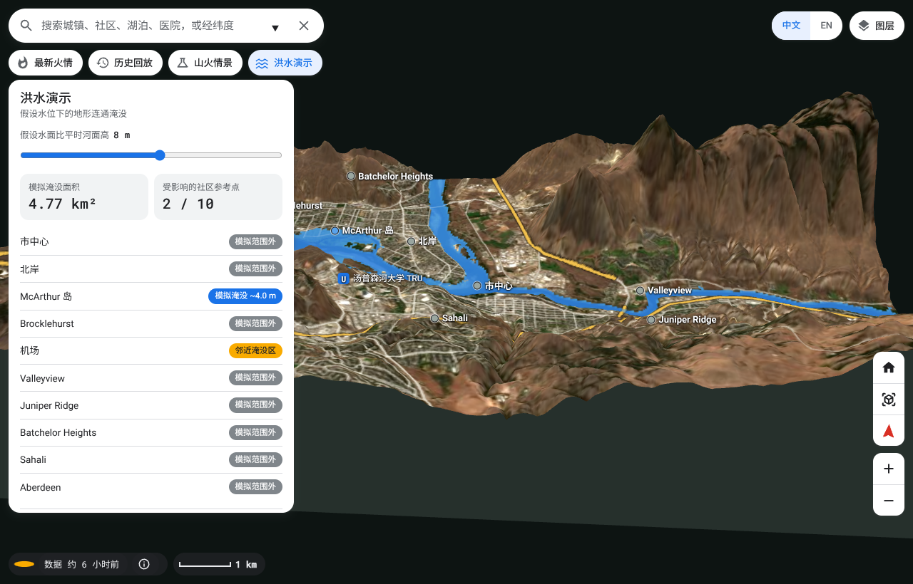
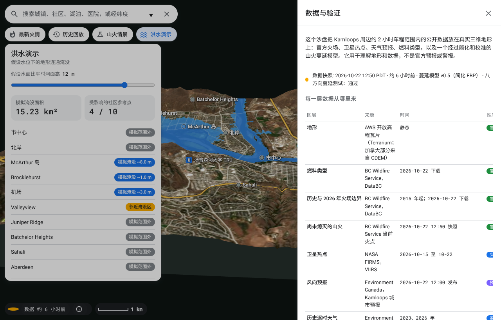

# Kamloops 3D Risk Sand Table

A single-file, browser-based 3D "sand table" that puts public wildfire, weather, satellite and terrain data for a two-hour drive around Kamloops, BC on real 3D terrain — and runs a simplified, calibrated fire-spread model in the browser.

**[Live demo](https://claude.ai/artifact/XGLxZh81oW5z7C9v8WuCBc)** · [Demo video (1:45, English UI)](docs/demo-en.mp4) · [Method & limits](docs/METHOD.md) · [中文说明](#中文说明)

> This is a demonstration and learning tool, **not** an official forecast or alert. For real emergencies see [EmergencyInfoBC](https://www.emergencyinfobc.gov.bc.ca/) and [BC Wildfire Service](https://wildfiresituation.nrs.gov.bc.ca/).



## What it does

| Mode | What you see |
|---|---|
| **Latest fires** | BC Wildfire Service fires not yet declared out, NASA FIRMS VIIRS hotspots (7 days), Environment Canada wind forecast, large fires since 2015 — on Sentinel-2 true-colour imagery over a 268 × 282 km region (640 × 640 cells, ~420 m) |
| **Fire replay** | Three real fires re-run by the model and compared with official perimeters and size reports: Rossmoore Lake 2023, Bradley Creek 2026, Jacko Lake 2026 |
| **Wildfire scenario** | Pick an ignition point, choose wind (forecast or manual), dryness and a calibrated spread coefficient; a Web Worker computes 24 h of spread; scrub the timeline; towns get distance-to-fire-line reference rings |
| **Flood demo** | City-scale (30 m) terrain at an assumed river rise: connected flooding from the Thompson rivers, neighbourhood status |
| **Data & checks** | Every layer with source, date and kind; the model card; validation results; links to the original data |

Also: place card for any point (elevation, nearest highway, fuel type, past fire, arrival time, 24 h weather chart), search, satellite / hillshade base map, terrain-height slider, top-down / 3D, Chinese + English UI, phone layout.

<p>
 
 
</p>

## How it is built

- **No framework, no build step for the app itself.** `build.py` concatenates `src/ui.html` (CSS + HTML), `src/engine.js` (terrain, painting, spread model, worker, camera) and `src/ui.js` (interface) with the processed data into one 6 MB HTML file. Only external dependency: Three.js r128 + OrbitControls from a CDN; icons are inline SVG so nothing else is fetched.
- **Terrain** is a `PlaneGeometry` with elevations from AWS Terrarium tiles, hillshade baked into a canvas texture, Sentinel-2 imagery blended with the shade. Labels are DOM elements with simple collision hiding.
- **Fire spread** is a simplified Canadian FBP: per-fuel-type rate of spread from ISI (ISI from daily FFMC and hourly wind), wind ellipse (length-to-breadth), slope factor, night factor, then a Dijkstra arrival-time solve on the grid in a Web Worker. See [docs/METHOD.md](docs/METHOD.md).
- **Calibration**: one global coefficient K fitted on Rossmoore Lake 2023 (K = 0.060, Sørensen overlap 0.64 at the equal-area hour); the 2026 fires are run both with that coefficient and with a per-event fit, and the mismatch is shown rather than hidden.
- **Data pipeline** (`scripts/`) downloads everything from public APIs and writes JSON snapshots into `data/`. Snapshot in this repo: 2026-10-22 12:50 PDT.

## Run it

```bash
python3 build.py                 # -> dist/kamloops-risk.html and dist/_preview.html
python3 -m http.server -d dist   # open http://localhost:8000/_preview.html
```

`dist/kamloops-risk.html` is a page *body* (no `<html>`/`<head>`) intended for embedding; `_preview.html` wraps it as a standalone page.

### Regenerate the data

Requires Python 3.10+, `numpy`, `pillow`, `shapely`, `rasterio`, and network access to DataBC, NASA FIRMS, Environment Canada, AWS Terrain Tiles and Earth Search (Sentinel-2).

```bash
W=work && mkdir -p $W/fire $W/demdata
python3 scripts/build_dem.py   $W/demdata        # Kamloops city DEM (30 m)
python3 scripts/prep_fire.py   $W                # fuel types, Rossmoore 2023 calibration, live fires -> fire_assets.json
python3 scripts/prep_replay.py $W                # Bradley Creek + Jacko Lake 2026 replays -> replay2026.json
python3 scripts/prep_region.py $W                # 2-hour-drive region DEM / fuel / history -> region_assets.json
python3 scripts/merge_assets.py $W               # -> all_assets.json
python3 scripts/prep_poi.py    $W                # towns, highways, lakes, hospitals -> poi.json
python3 scripts/prep_imagery.py $W               # Sentinel-2 mosaics -> imagery.json
cp $W/all_assets.json $W/poi.json $W/imagery.json $W/city_fuel.b64 data/ && cp $W/demdata/dem.* data/demdata/
python3 scripts/acc.py                           # 8-direction flat-terrain test of the spread solver
```

### Tests

```bash
pip install playwright && playwright install chromium
python3 tests/functional.py          # desktop: every mode, search, scenario compute, timeline, layers, drawer, EN/ZH
python3 tests/functional.py mobile   # phone layout
python3 tests/overlap.py             # bounding-box overlap check of floating controls at 5 viewport sizes
```

## Live data (v0.7, 2026-10-26)

A fifth mode, **Weather risk**, reads Environment and Climate Change Canada and Water Survey of Canada open data directly in the browser (all CORS-enabled, no server in between):

- weather alerts (`api.weather.gc.ca` weather-alerts), shown as a banner in every mode;
- HRDPS 2.5 km forecast fields — wind, accumulated precipitation, accumulated snow, temperature — for the next 48 h, fetched as small GeoTIFF tiles from GeoMet WCS, decoded and colour-mapped in the page, draped on the terrain, with values at every town and at any clicked point;
- the latest 1 km radar composite (GeoMet WMS);
- station observations of the last hour (SWOB) and the three Thompson River gauges (level, flow, 72 h sparkline, 24 h change);
- the Kamloops city forecast, which also replaces the built-in wind snapshot in the wildfire scenario; the scenario can alternatively take the HRDPS wind at the ignition point.

Every chip shows its source and age; past a per-source threshold it turns amber and says "may be stale". An **Official live information** button links EmergencyInfoBC, BCWS, TNRD, the City, DriveBC, ECCC and the River Forecast Centre.

BC-government layers (evacuation orders, current fires, danger rating, perimeters) do not send CORS headers. `worker/` contains a Cloudflare Worker that caches them on a 48-hour schedule and serves them with ETag + CORS; set `WORKER_BASE` in `src/live.js` after deploying it (see `worker/README.md`).

The spread model is v0.6: hourly fine-fuel moisture (Van Wagner 1977) and a time-decaying rate coefficient calibrated jointly on Jacko Lake 2026 and the corrected Rossmoore Lake 2023 timeline; see `docs/METHOD.md` §3–4 for the fit and for the alternatives that were tried and rejected.

## Data sources

| Layer | Source | Licence |
|---|---|---|
| Elevation | AWS Terrain Tiles (Terrarium; Canadian coverage from NRCan CDEM) | [Attribution](https://github.com/tilezen/joerd/blob/master/docs/attribution.md) |
| Fuel types, fire perimeters (current + historical), roads, place names, hospitals/schools | Province of British Columbia, DataBC WFS/WMS | [Open Government Licence – BC](https://www2.gov.bc.ca/gov/content/data/open-data/open-government-licence-bc) |
| Current fires | BC Wildfire Service via DataBC | OGL-BC |
| Satellite hotspots | NASA FIRMS, VIIRS | [NASA FIRMS](https://firms.modaps.eosdis.nasa.gov/) |
| Weather forecast and hourly history | Environment and Climate Change Canada (MSC GeoMet / Datamart) | [ECCC data licence](https://eccc-msc.github.io/open-data/licence/readme_en/) |
| Satellite imagery | ESA Copernicus Sentinel-2 L2A true colour, via Earth Search / AWS | Contains modified Copernicus Sentinel data 2022–2026 |

See [DATA-LICENSES.md](DATA-LICENSES.md). Code is MIT-licensed.

## Status and limits

- The spread model is a teaching-grade simplification of FBP (no spotting, no suppression, no fuel moisture other than daily FFMC, no crown-fire transition). Validation results are in the app and in [docs/METHOD.md](docs/METHOD.md); the Jacko Lake replay shows the model is far too slow on grass fires with the 2023 coefficient.
- Data are snapshots, not live. The status chip shows the snapshot age.
- Region imagery is ~200 m/pixel; city imagery ~20 m/pixel.
- Built by one person with AI assistance in about a week as a portfolio and demo project.

## Author

Neil Xiang — 20 years in C++ graphics and 3D map rendering (rendering-engine lead at AutoNavi/Amap 2015–2023, tech lead at Tencent Maps 2023–2025, 9 patents in lane-level rendering and navigation). Now in Kamloops, BC. Open to remote senior graphics / 3D / geospatial engineering roles and contracts.

---

## 中文说明

这是一个单文件的浏览器三维"风险沙盘"：把 Kamloops 周边约两小时车程范围内的公开数据（官方火场、卫星热点、天气预报、燃料类型、历史火灾）放在真实三维地形和 Sentinel-2 卫星影像上，并在浏览器里运行一个经过简化和校准的山火蔓延模型。

**它不是官方预报或警报**，只用于理解地形、数据和模型。

四个模式：最新火情、历史回放（用 2023 和 2026 年三场真实火灾验证模型）、山火情景推演（24 小时蔓延，后台计算）、洪水演示（城区 30 米网格的连通淹没）。另有"数据与验证"抽屉，列出每一层数据的来源、日期和模型卡片。

构建：`python3 build.py`，把 `src/` 的三个文件和 `data/` 的数据拼成 `dist/kamloops-risk.html`。数据用 `scripts/` 里的脚本从公开 API 重新生成。详见上文英文部分。

作者：Neil Xiang（Xiang Qian），前高德地图渲染引擎负责人、腾讯地图技术负责人，20 年 C++ 图形与三维地图渲染经验，现居 BC 省 Kamloops。
